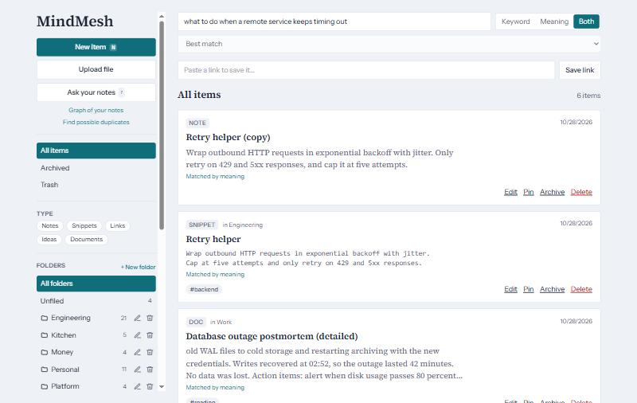
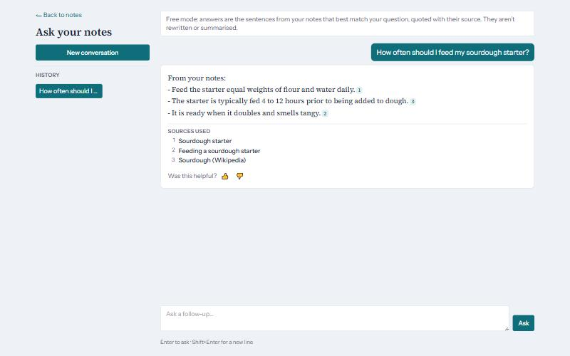
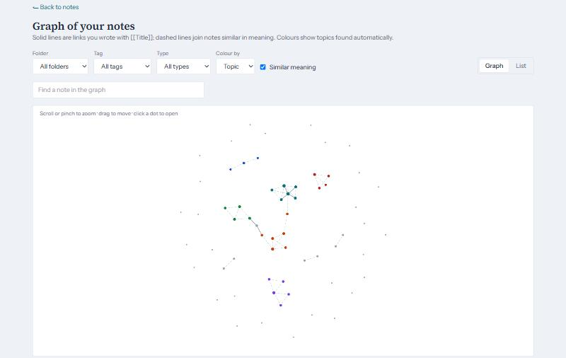
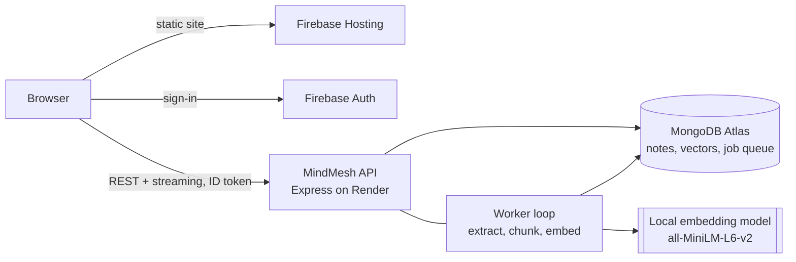

# MindMesh

**A personal knowledge base that understands what your notes mean.** Capture notes, code snippets, links and documents; find them by meaning, ask questions answered only from your own notes (with citations), and let it suggest tags, spot duplicates and show how your ideas connect.

**Live demo: https://mindmesh-267a3.web.app**. Create an account with email or Google. It runs on free hosting, so after a quiet spell the first request takes up to a minute while the server wakes; the app tells you when that happens.

Everything is free to run: search, answers and suggestions use a small embedding model on the server itself, with no paid AI API. (Claude can optionally write answers if you add an API key.)

| Search by meaning | Answers from your notes | How your notes connect |
|---|---|---|
|  |  |  |

## What it does
- **Capture fast:** notes, snippets, ideas, links (title and description fetched safely) and uploaded PDF, Word, Markdown and text files. Folders, tags, pins, archive, trash with 30-day restore. Keyboard shortcuts (`N`, `/`, `Ctrl+Enter`).
- **Search by meaning:** "what to do when a service keeps timing out" finds your *Retry helper* note. Keyword, meaning or both, with filters.
- **Ask your notes:** questions are answered only from your notes, every sentence cited. Free "smart quotes" mode quotes the best-matching sentences; Claude can write the answer instead if you add a key.
- **Organises with you:** related notes, tag and folder suggestions while you write, a warning before you save a near-duplicate, a "Possible duplicates" page, and key points for long documents.
- **Connects ideas:** `[[Note title]]` links with suggestions and backlinks, a graph of links and similar meaning, and topics found automatically.
- **Works on phones:** responsive layout with a slide-out menu.

## How it is built


| Part | Technology |
|---|---|
| Web app | Next.js 15 (static export), React 19, Tailwind, d3-force graph |
| API | Node 20, Express 5, Mongoose 8, Zod validation, Firebase Admin |
| Search | MongoDB Atlas Vector Search (in-memory fallback), keyword + meaning fused by reciprocal rank |
| AI | `Xenova/all-MiniLM-L6-v2` embeddings on the server (free); extractive answers; optional Claude |
| Background work | Job queue in MongoDB; worker runs separately or inside the API |
| Quality | 181 automated API tests, GitHub Actions CI, four free evaluation suites with tuned thresholds |
| Operations | Structured JSON logs with request ids, rate limits, health and readiness checks, CSP and security headers |

```
apps/api     Express API, worker, evals (eval/), scripts (demo-seed, reembed, prefetch-model)
apps/web     Next.js web app
docs/        deploy and operations guides, evaluation reports, images
render.yaml  Render blueprint for the API · firebase.json  Hosting config and security headers
```

## Run it locally
You need Node 20, a free [MongoDB Atlas](https://www.mongodb.com/atlas) cluster and a free [Firebase](https://console.firebase.google.com) project with Authentication enabled.

1. Install dependencies:
   ```bash
   npm install
   ```
2. Copy the settings templates and fill them in: `apps/api/.env.example` → `apps/api/.env` (database and Firebase service account), `apps/web/.env.example` → `apps/web/.env` (Firebase web config). The comments in each file say where every value comes from.
3. Start the API, the worker and the web app (three terminals):
   ```bash
   npm run dev:api
   ```
   ```bash
   npm run dev:worker
   ```
   ```bash
   npm run dev:web
   ```
4. Open http://localhost:3000 and create an account. To fill it with a demo library (about 65 notes):
   ```bash
   npm run demo:seed -w apps/api -- --email you@example.com
   ```

The first time, the API downloads the 23 MB embedding model.

## Test and check
```bash
npm run check
```
That runs the typecheck, the API tests (in-memory database and fake models, no accounts needed), and both production builds. CI runs the same on every push.

Evaluations (free, local model) measure search, answers, suggestions and connections against labelled data and write the reports in [docs/eval](docs/eval): `npm run eval:search`, `eval:ask`, `eval:organize`, `eval:connections` (each with `-w apps/api`).

## Deploy and operate
- [docs/deploy.md](docs/deploy.md): deploy for free on Firebase Hosting, Render and MongoDB Atlas (about 30 minutes, no card).
- [docs/operations.md](docs/operations.md): health checks, logs and request ids, error codes, limits, key rotation, backups.

## How it was built
MindMesh was built in seven phases, each with its own design notes, results and test scenarios:

| Phase | What it added |
|---|---|
| [1](phase1_Readme.md) | Sign-in, notes, tags, keyword search |
| [2](phase2_Readme.md) | Item types, folders, link capture, filters, trash |
| [3](phase3_Readme.md) | Background processing, embeddings, search by meaning |
| [4](phase4_Readme.md) · [tests](phase4_Test_Scenarios.md) | Ask your notes, with citations, free by default |
| [5](phase5_Readme.md) · [tests](phase5_Test_Scenarios.md) | Related notes, suggestions, duplicates, key points |
| [6](phase6_Readme.md) · [tests](phase6_Test_Scenarios.md) | `[[Links]]`, graph view, topics |
| [7](phase7_Readme.md) · [tests](phase7_Test_Scenarios.md) | Hardening, CI, free deployment, demo data |

## API at a glance
All `/api/*` routes need `Authorization: Bearer <Firebase ID token>` and only ever touch the signed-in user's data. Errors are `{ "error": { "code", "message", "requestId" } }`.

| Area | Endpoints |
|---|---|
| Health | `GET /health` · `GET /ready` |
| Notes | `GET/POST /api/notes` · `GET/PATCH/DELETE /api/notes/:id` · `POST /api/notes/:id/restore` · `DELETE /api/notes/:id/permanent` · `DELETE /api/notes/trash` · `GET /api/notes/tags` · `POST /api/notes/capture-url` · `POST /api/notes/upload` · `POST /api/notes/:id/reprocess` |
| Folders | `GET/POST /api/folders` · `PATCH/DELETE /api/folders/:id` |
| Search | `GET /api/search?q=&mode=keyword\|semantic\|hybrid` · `GET /api/search/usage` |
| Ask | `POST /api/ask` (server-sent events) · `GET /api/ask/status` · `GET /api/conversations` · `GET/PATCH/DELETE /api/conversations/:id` · `POST /api/conversations/:id/turns/:n/feedback` |
| Organize | `GET /api/organize/related/:id` · `POST /api/organize/suggest` · `GET /api/organize/duplicates` |
| Connections | `GET /api/connections/links/:id` · `GET /api/connections/graph` · `GET /api/connections/topics` |

Details for each are in the phase readmes.
